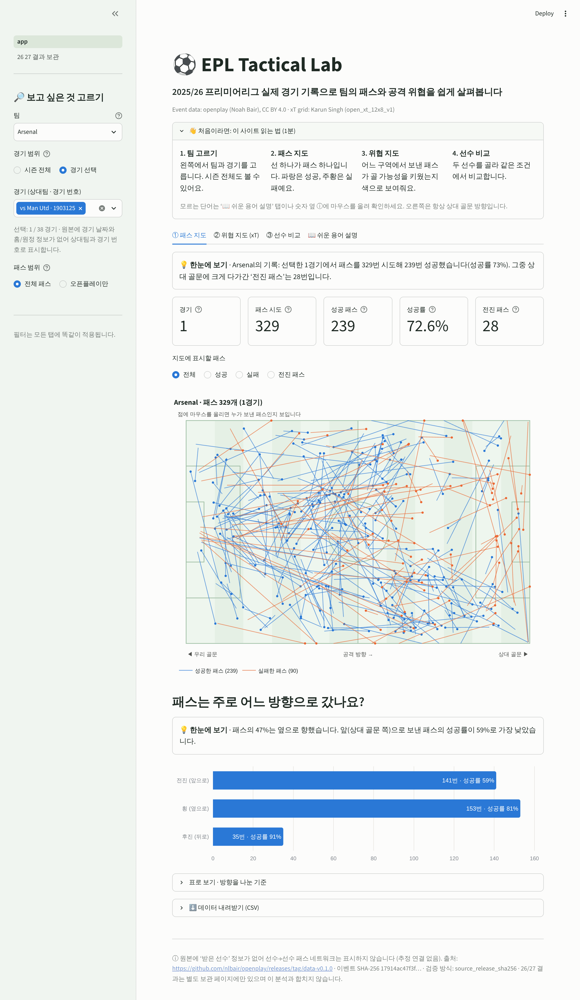

# EPL Tactical Lab — 2025/26 패스 · xT · 선수 비교

실제 공개 이벤트 데이터(OpenPlay, EPL 2025/26)만으로 만든 Streamlit 전술 분석 앱.
팀·경기를 고르면 **실제 패스 위치 지도 → 위치별 xT 히트맵 → 선수 2명 비교**가 같은 필터로 함께 바뀐다.



## 기능
| 탭 | 내용 |
|---|---|
| ① 패스 지도 | 전체 패스 지도(샘플링 없음, 점에 마우스를 올리면 선수·결과·xT 표시), 방향 분포(전진·횡·후진), 전진 패스 수, 필터된 패스 CSV 내려받기 |
| ② 위협 지도 (xT) | 위협 점수(xT) 합계(+/− 분리), 출발·도착 위치별 히트맵(칸에 마우스를 올리면 구역 이름·값), 위치별 성공 패스 수, 사용한 xT 그리드, 같은 경기 상대팀 비교 |
| ③ 선수 비교 | 같은 필터에서 두 선수 비교(막대·표·차이), 지표별 선수 순위(최소 시도 수) |
| 📖 쉬운 용어 설명 | 축구를 잘 몰라도 읽을 수 있는 용어 사전, ‘이 사이트가 하지 않는 것’, 데이터 출처 |
| 공통 필터 | 팀, 경기 범위(시즌 전체/경기 선택), **패스 범위(전체/오픈플레이만)** — 모든 탭에 동시에 적용 |
| 처음 보는 사람을 위한 장치 | 첫 화면의 ‘이 사이트 읽는 법’, 숫자마다 ⓘ 도움말, 각 탭의 💡 한눈에 보기 문장(화면 숫자로만 만든 고정 문장), 경기장에 우리/상대 골문·공격 방향 표시 |

스크린샷: [위협 지도](docs/screenshots/02_xt_heatmap.png) · [선수 비교](docs/screenshots/03_player_comparison.png) · [시즌 전체 패스](docs/screenshots/04_season_passing.png) · [오픈플레이 xT](docs/screenshots/05_openplay_xt.png) · [용어 설명](docs/screenshots/06_glossary.png) · 시연 순서: [docs/demo.md](docs/demo.md)

## 실행 방법 (Windows PowerShell 기준, Python 3.11+)
```powershell
py -3.11 -m venv .venv
.\.venv\Scripts\Activate.ps1
python -m pip install -r requirements.txt
python scripts/download_openplay_2526.py
python scripts/audit_openplay_2526.py
python -m pytest -q
streamlit run app.py
```
macOS/Linux는 `python3 -m venv .venv && source .venv/bin/activate` 후 같은 명령을 쓴다.

- `download_openplay_2526.py`(인터넷 필요, 약 11.5MB): OpenPlay 원본 Parquet을 받아 배포처 `checksums.json`의 SHA-256과 대조하고, xT 그리드 JSON을 고정된 SHA-256과 대조한 뒤 `data/processed/passes.csv`, `xt_grid.csv`, `matches.csv`와 `config/source_manifest.json`을 만든다. 체크섬이 다르면 중단한다.
- `audit_openplay_2526.py`: 원본을 다시 측정해 [`docs/data_quality_report.md`](docs/data_quality_report.md)를 생성한다.
- 앱은 시작할 때마다 manifest의 해시로 가공 파일을 다시 검증하며, 데이터가 없거나 변조되면 숫자 대신 준비 방법만 표시한다.
- 데이터 파일(`data/`)과 생성된 manifest는 Git에 넣지 않는다(`.gitignore`).
- 데이터가 없으면 앱에서 **원본 내려받기 및 검증** 버튼으로 같은 파이프라인을 실행할 수 있다. 배포(Streamlit Community Cloud)는 [`docs/deployment.md`](docs/deployment.md) 참고.

## 데이터 출처와 검증 결과
| 항목 | 값 |
|---|---|
| 이벤트 | openplay (Noah Bair), release `data-v0.1.0`, `events_eng_2526.parquet` — **CC BY 4.0** · https://github.com/nlbair/openplay/releases/tag/data-v0.1.0 |
| 이벤트 SHA-256 | `17914ac47f3f2d582fb8f94d27bf930a4b092a6e1ecb48887b5f9d82b46bcdb9` (배포처 체크섬과 일치) |
| xT 그리드 | Karun Singh `open_xt_12x8_v1.json` · https://karun.in/blog/expected-threat.html · SHA-256 `5d8e9aaa…5a7f` 고정 |
| 측정값 (2026-11-25) | 이벤트 577,884행, **380경기 · 20팀(팀당 38경기) · 패스 362,739건**(성공 290,873 / 실패 71,866), 좌표 결측·범위 이탈·제외 0건 |

세부 측정값(중복, 결측, 좌표 범위, 그리드 방향)은 [`docs/data_quality_report.md`](docs/data_quality_report.md), 컬럼·지표 정의는 [`docs/data_contract.md`](docs/data_contract.md).

## 지표 정의 (요약)
- **좌표:** OpenPlay 원본 0..100, 모든 팀이 x=100 방향으로 공격. 각도·거리는 105×68m 표준 경기장으로 환산(근사).
- **방향:** 공격 방향 기준 |각도| < 45° 전진, > 135° 후진, 그 사이 횡.
- **전진 패스:** 성공 패스 중 상대 골문 중앙까지 거리가 25% 이상 줄어든 패스.
- **xT:** 성공 패스의 xT(도착 칸) − xT(출발 칸), 부호 유지. 실패 패스는 0. 12×8 칸, x=100·y=100은 마지막 칸.
- **선수:** (팀, 선수) 단위 집계 — 이적 선수(14명)는 팀별로 분리. "경기 수"는 패스를 1회 이상 시도한 경기 수.

## 한계 (앱에도 표시)
- **패스 수신자 없음:** 원본에 수신자 필드가 없어(`related_player_id`도 패스에서 100% 비어 있음) 선수→선수 패스 네트워크를 만들지 않는다. 추정 연결도 표시하지 않는다.
- **출전 시간 없음:** 90분당 지표를 제공하지 않는다.
- **xT 그리드:** 과거 EPL 시즌으로 만든 공개 모델을 재사용한 것이며 2025/26으로 재학습하지 않았다. 패스의 위치 가치 변화 지표이지 득점·승리 확률 예측이 아니다.
- **세트피스:** 기본값은 코너·프리킥·스로인·골킥 재개 패스를 포함한다. `패스 범위 = 오픈플레이만`은 원본 제공자 플래그로 이 패스(32,271건)를 제외한다. 킥오프는 원본에 플래그가 없어 제외되지 않는다. 재개 패스 비중이 팀마다 달라 xT 순위가 바뀐다(예: Arsenal 46.29 → 32.69).
- **경기 날짜·홈/원정 없음:** 경기 선택지는 데이터에서 계산한 상대팀과 match_id만 표시한다.
- 26/27 시즌은 경기 결과만 별도 보관 페이지(`pages/99_26_27_결과_보관.py`)에 있으며 25/26 분석과 합치지 않는다. 결과 CSV는 저장소에 없어서 관련 테스트 5개는 사유와 함께 skip된다.

## 테스트
`python -m pytest -q` → **64 passed, 5 skipped** (2026-11-25, 이 브랜치). 합성 데이터 테스트는 `SYNTHETIC_TEST_ONLY`로 표시되며 실데이터로 표시되지 않는다. 실데이터 수치는 원본 Parquet에서 별도 구현으로 다시 계산해 일치를 확인했다(기록: [`docs/claude_harness_plan.md`](docs/claude_harness_plan.md)).

## 코드 구조
- `app.py` — Streamlit UI (탭 4개, 공통 필터, 테마는 `.streamlit/config.toml`)
- `src/epl_xt/openplay_adapter.py` — 원본 → 표준 패스 표 (수신자 추정 금지)
- `src/epl_xt/passing.py` · `xt.py` · `players.py` — 패스 · xT · 선수 지표
- `src/epl_xt/charts.py` · `narrative.py` · `app_data.py` · `pipeline.py` — Plotly 차트, 쉬운 말 요약 문장, 검증된 데이터 로딩, 다운로드·검증·변환 파이프라인
- `src/epl_xt/quality.py` · `provenance_2526.py` · `validation.py` — 품질 감사, 무결성, 스키마 검증
- `scripts/` — 다운로드, 품질 감사, (26/27) 경기 통계 갱신

## 저작자 표기
Event data: **openplay (Noah Bair)**, CC BY 4.0. xT grid: **Karun Singh**, https://karun.in/blog/expected-threat.html.
EPL·구단 로고, 사진, 중계 영상은 사용하지 않는다.
